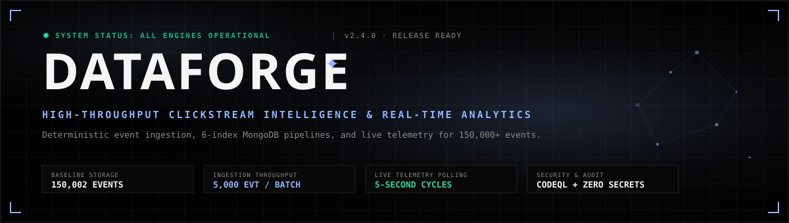
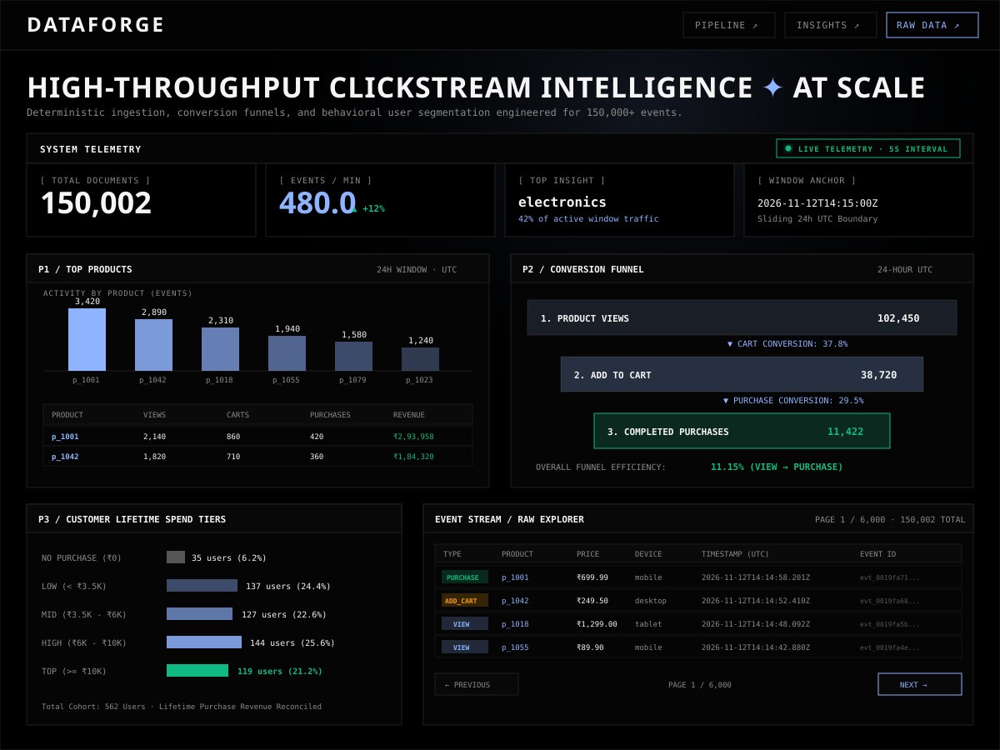
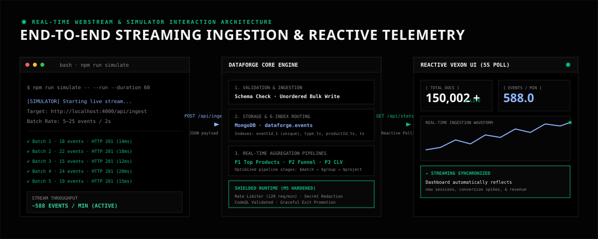
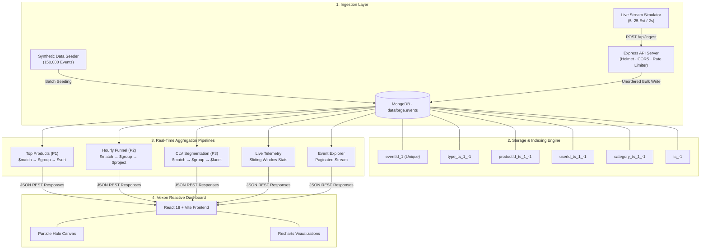

<div align="center">



# DataForge

### Enterprise-Grade E-Commerce Clickstream Intelligence & Real-Time Analytics

[](https://github.com/Gagann-09/DataForge/actions/workflows/ci.yml)
[](https://github.com/Gagann-09/DataForge/actions/workflows/codeql.yml)
[](https://nodejs.org/)
[](https://www.mongodb.com/)
[](https://react.dev/)
[](https://github.com/Gagann-09/DataForge)

[Live Dashboard](#-live-dashboard--webstream) · [Key Capabilities](#-key-capabilities) · [System Architecture](#-system-architecture) · [Quick Start](#-quick-start) · [Stream Simulator](#-real-time-stream-simulator) · [API Reference](#-api-reference) · [Production Hardening](#-security--production-hardening)

</div>

---

## ⚡ Overview

**DataForge** is a high-throughput clickstream analytics platform engineered to ingest, index, and analyze massive e-commerce user activity in real time. Powered by an Express.js ingestion engine, MongoDB aggregation pipelines with six purpose-built indexes, and an industrial **Vexon Dark Technical** React dashboard, DataForge transforms raw behavioral events into actionable product insights, conversion funnels, and customer lifetime-spend segments.

---

## 🖥️ Live Dashboard & Webstream

The DataForge frontend is an industrial dark technical dashboard built with **React 18**, **Vite**, **Recharts**, and an interactive HTML5 canvas particle field.

<div align="center">
  
</div>

### Interactive Dashboard Components

- **System Telemetry Bar (`/api/stats`):** Polled reactively every 5 seconds. Displays total document count, real-time throughput velocity (`events/min`), dominant product category share, and sliding window boundaries. Automatically flags static historical snapshots with a `STATIC DATASET` badge if no new events arrive within 15 minutes.
- **P1 · Top Products Leaderboard (`/api/p1/top-products`):** Interactive bar chart and tabular leaderboard ranking products by activity over an inclusive 24-hour UTC window. Accurately calculates purchase-only revenue (`price × quantity`).
- **P2 · Hourly Conversion Funnel (`/api/p2/funnel`):** Visualizes the user conversion lifecycle (**View → Add to Cart → Purchase**) across 24 UTC hourly buckets, calculating stage-by-stage and overall funnel conversion rates with zero-filled missing periods.
- **P3 · Customer Lifetime Spend Segments (`/api/p3/segments`):** Categorizes users into five distinct lifetime spend tiers (`no_purchase`, `low`, `mid`, `high`, `top`) with spend averages and event distributions.
- **Raw Event Stream Explorer (`/api/events`):** High-speed tabular stream log featuring multi-type filtering (`view`, `add_to_cart`, `purchase`), ISO-8601 date-range pickers, deep pagination controls, and query protection.

---

## 🔄 Real-Time Stream Simulator

DataForge includes an opt-in synthetic traffic streaming simulator (`server/scripts/simulate.js`) that models active e-commerce user sessions and streams live events into the ingestion pipeline.

<div align="center">
  
</div>

### Streaming Feedback Loop

1. **Synthetic Traffic Generation:** Streams randomized micro-batches (5–25 events every 2 seconds) exclusively through `POST /api/ingest`.
2. **Deterministic Session Simulation:** Simulates realistic user browsing behavior with probabilistic transitions: `view` (60%) → `add_to_cart` (25%) → `purchase` (15%).
3. **Reactive UI Updates:** The dashboard detects live ingestion via its 5-second polling cycle, dynamically updating real-time event counters, velocity graphs, and funnel metrics without full page reloads.
4. **Safety Guards:** Guarded by mandatory `--run` / `SIMULATE=true` flags and an enforced 300-second execution ceiling to safeguard database environments.

```bash
# Launch live simulator for 60 seconds against local ingestion API
npm run simulate -- --run --duration 60
```

---

## ✨ Key Capabilities

| Capability | Specification | Architectural Advantage |
|---|---|---|
| **Bulk Ingestion** | Up to 5,000 events / batch (`POST /api/ingest`) | Unordered bulk writes (`ordered: false`) with schema verification |
| **High Concurrency** | In-memory sliding window rate limiting | 120 req/min per IP with RFC 6585 retry headers |
| **Storage & Scale** | 150,000+ verified baseline events | 6 purpose-built compound and single-field MongoDB indexes |
| **Sub-50ms Analytics** | MongoDB Aggregation Pipelines | Single-pass `$facet`, `$bucket`, and `$group` aggregations |
| **Clean Telemetry** | 5-second polling interval (`GET /api/stats`) | Low-latency sliding window metrics without database degradation |
| **Credential Redaction** | Comprehensive secret sanitization | Strips Mongo URIs, bearer tokens, API keys, and URL query params |
| **Log Hygiene** | Zero-query request logging | Protects credentials from leaking into server access logs |
| **Fault Resilience** | Dual-tier error handling & exit-code promotion | Graceful shutdown guarantees fatal exit codes on error races |

---

## 🧱 System Architecture



---

## 🚀 Quick Start

### 1. Prerequisites

- **Node.js**: v18.0.0 or higher
- **MongoDB**: v6.0 or higher (running locally or reachable via URI)
- **npm**: v9.0 or higher

### 2. Installation

Clone the repository and install all root, server, and client dependencies:

```bash
git clone https://github.com/Gagann-09/DataForge.git
cd DataForge
npm run install:all
```

### 3. Environment Configuration

```bash
# macOS / Linux
cp server/.env.example server/.env

# Windows PowerShell
Copy-Item server/.env.example server/.env
```

| Environment Variable | Default Value | Description |
|---|---|---|
| `PORT` | `4000` | Express API listening port |
| `MONGODB_URI` | `mongodb://127.0.0.1:27017` | MongoDB connection connection string |
| `DB_NAME` | `dataforge` | Target database name |
| `COLLECTION_NAME` | `events` | Target events collection |
| `SEED_COUNT` | `150000` | Target event count for batch seeder |
| `TRUST_PROXY` | `false` | Reverse proxy trust configuration (`true`, `false`, or CIDR) |

### 4. Seed Database & Create Indexes

Generate the 150,000 baseline e-commerce clickstream events and build production indexes:

```bash
# Seed 150,000 events (batches of 5,000)
npm run seed

# Verify or create indexes independently
npm run indexes --prefix server -- create
npm run indexes --prefix server -- verify
```

### 5. Launch Application

Run both backend API and frontend dashboard concurrently:

```bash
npm run dev
```

- **Frontend Dashboard:** [http://localhost:5173](http://localhost:5173)
- **Backend API:** [http://localhost:4000](http://localhost:4000)
- **Health Check:** `curl http://localhost:4000/api/health`

---

## 🔌 API Reference

All endpoints return JSON and are prefixed with `/api`. Request bodies are limited to 5 MB.

| Endpoint | Method | Key Parameters | Description |
|---|---|---|---|
| `/api/health` | `GET` | None | Verifies MongoDB connectivity and cluster status |
| `/api/ingest` | `POST` | `events` (Array, max 5,000) | Bulk ingests events with schema validation & unordered writes |
| `/api/p1/top-products` | `GET` | `to` (ISO-8601, optional) | Top 10 products by activity with purchase-only revenue in 24h UTC |
| `/api/p2/funnel` | `GET` | `to` (ISO-8601, optional) | 24-hour UTC hourly view → cart → purchase conversion rates |
| `/api/p3/segments` | `GET` | None | 5-tier customer lifetime spend segmentation with revenue totals |
| `/api/events` | `GET` | `type`, `from`, `to`, `page`, `limit` | Paginated event stream with multi-type and date range filters |
| `/api/stats` | `GET` | `to`, `windowMinutes` (1–60) | Live telemetry: total documents, events/min, and top category share |

<details>
<summary><b>View Sample Request & Response Payloads</b></summary>

#### `POST /api/ingest`
```bash
curl -X POST http://localhost:4000/api/ingest \
  -H "Content-Type: application/json" \
  -d '{
    "events": [{
      "eventId": "evt_live_001",
      "userId": "u_8842",
      "sessionId": "s_9921",
      "type": "purchase",
      "productId": "p_1001",
      "category": "electronics",
      "price": 699.99,
      "quantity": 1,
      "device": "mobile",
      "country": "IN",
      "ts": "2026-11-12T14:20:00.000Z"
    }]
  }'
```
```json
{
  "ok": true,
  "received": 1,
  "inserted": 1,
  "duplicates": 0,
  "failed": 0
}
```

#### `GET /api/stats`
```json
{
  "totalEvents": 150002,
  "eventsPerMinute": 480.0,
  "window": {
    "from": "2026-11-12T14:15:00.000Z",
    "to": "2026-11-12T14:20:00.000Z",
    "durationMinutes": 5
  },
  "eventsInWindow": 2400,
  "topInsight": {
    "type": "top_category",
    "category": "electronics",
    "events": 1020,
    "share": 42.5,
    "description": "electronics is leading current activity with 1,020 events (42.5% of window traffic)"
  }
}
```

#### `GET /api/p3/segments`
```json
{
  "data": [
    { "segment": "no_purchase", "users": 35, "totalSpend": 0, "avgSpend": 0, "avgEvents": 142.3 },
    { "segment": "low", "users": 137, "totalSpend": 278450.2, "avgSpend": 2032.48, "avgEvents": 215.8 },
    { "segment": "mid", "users": 127, "totalSpend": 591240.5, "avgSpend": 4655.44, "avgEvents": 290.1 },
    { "segment": "high", "users": 144, "totalSpend": 1124500.0, "avgSpend": 7809.03, "avgEvents": 348.6 },
    { "segment": "top", "users": 119, "totalSpend": 1639272.51, "avgSpend": 13775.4, "avgEvents": 412.9 }
  ]
}
```

</details>

---

## 🗃️ Event Data Model & Indexes

Each clickstream document conforms to the following strict schema:

```typescript
interface ClickstreamEvent {
  eventId: string;          // Unique UUID event identifier
  userId: string;           // Consistent user identifier
  sessionId: string;        // Session identifier
  type: 'view' | 'add_to_cart' | 'purchase';
  productId: string;        // Catalog identifier (80 products)
  category: string;         // 8 categories: electronics, clothing, books, etc.
  price: number;            // Floating-point unit price
  quantity: number;         // Positive integer quantity
  device: 'mobile' | 'desktop' | 'tablet';
  country: 'IN';            // Geolocation constraint
  ts: Date;                 // BSON Date timestamp
}
```

### Production Index Strategy

| Index Name | Key Pattern | Operational Purpose |
|---|---|---|
| `eventId_1` | `{ eventId: 1 }` (unique) | Idempotent deduplication across all ingest paths |
| `type_ts_1_minus_1` | `{ type: 1, ts: -1 }` | Fast filtering for conversion funnel calculations |
| `productId_ts_1_minus_1` | `{ productId: 1, ts: -1 }` | Sub-second product-centric activity aggregations |
| `userId_ts_1_minus_1` | `{ userId: 1, ts: -1 }` | Fast user history and session traversal |
| `category_ts_1_minus_1` | `{ category: 1, ts: -1 }` | Category-level telemetry and insight queries |
| `ts_minus_1` | `{ ts: -1 }` | Sliding window bounds and chronologically sorted queries |

---

## 🔒 Security & Production Hardening

DataForge is hardened for enterprise production environments:

- **Rate Limiting:** In-memory sliding window limiter restricting requests to 120 calls/min per client IP. Returns standard RFC 6585 `Retry-After` headers.
- **Security Headers & CORS:** Enforced via Helmet (`X-Content-Type-Options: nosniff`, `X-Frame-Options: DENY`, strict CSP) with restricted cross-origin policies.
- **Reverse Proxy Support:** Configurable `TRUST_PROXY` supporting boolean flags, specific loopback hops, and CIDR subnets without blind header trust.
- **Credential Redaction Pipeline (`sanitizeError`):** Automatically redacts MongoDB standard & SRV connection URIs, JWT bearer tokens, API keys, passwords, and sensitive query parameters across all error messages and stack traces.
- **Zero-Query Request Logging:** Request logging strictly records method, matched Express route pattern, HTTP status, and response latency — query parameters, request bodies, cookies, and auth tokens are never logged.
- **Graceful Lifecycle Management:** Handles `SIGINT` / `SIGTERM` signals with active connection draining and promotes exit codes to `1` on fatal process race conditions.
- **Automated Security Scanning:** Continuous static analysis with GitHub CodeQL SAST and weekly automated dependency patching via Dependabot.

---

## 🧪 Testing & Verification

The project maintains comprehensive unit and integration test suites:

```bash
# Run all 78 server unit tests
npm test --prefix server

# Run isolated integration suites against disposable database
npm run test:integration --prefix server

# Run frontend production build & typecheck
npm run build --prefix client
```

---

## 📄 License

This project is licensed under the MIT License - see the [LICENSE](LICENSE) file for details.

---

<div align="center">

**Crafted with precision for high-scale e-commerce intelligence.**

[Star on GitHub](https://github.com/Gagann-09/DataForge) · [Report Bug](https://github.com/Gagann-09/DataForge/issues) · [Submit Improvement](https://github.com/Gagann-09/DataForge/pulls)

</div>
