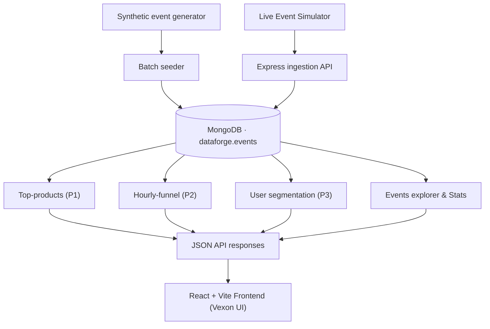

<div align="center">

# DataForge

### MongoDB-powered e-commerce clickstream analytics

**Generate realistic event data. Ingest it safely. Turn raw activity into useful product and funnel insights.**

[](https://github.com/Gagann-09/DataForge/stargazers)
[](https://github.com/Gagann-09/DataForge/network/members)
[](https://github.com/Gagann-09/DataForge/commits/main)
[](https://www.mongodb.com/)
[](https://nodejs.org/)

[Overview](#-overview) · [Features](#-implemented-features) · [Architecture](#-architecture) · [Quick start](#-quick-start) · [API](#-api-reference) · [Data model](#-event-data-model) · [Tests](#-tests)

</div>

---

## 🚀 Overview

DataForge is a high-performance MongoDB-based e-commerce clickstream analytics platform and live dashboard. It ingests synthetic and streaming user activity, stores immutable events in MongoDB, and delivers real-time product performance, hourly conversion funnels, customer lifetime-spend segmentation, and full event log exploration.

The platform includes an Express API backend, six purpose-built indexes, an opt-in live event simulator (`server/scripts/simulate.js`), comprehensive test suites (64 unit tests, 3 live integration suites), and an industrial Vexon-styled React + Vite frontend dashboard.

## ✨ Implemented features

| Area | Included capability |
|---|---|
| Synthetic data | Session-based e-commerce clickstream generation (`generate.js`) |
| Event streaming | Opt-in live traffic simulator submitting to `/api/ingest` (`simulate.js`) |
| Dataset size | 150,000 baseline events; configurable with `SEED_COUNT` |
| Event types | `view`, `add_to_cart`, `purchase` |
| Product catalog | 80 fixed products across 8 categories |
| Event ingestion | `POST /api/ingest`, batches up to 5,000 events with unordered bulk writes |
| Data integrity | Schema validation and unique `eventId` index |
| Product analytics (P1) | Top 10 products by event count with purchase revenue |
| Funnel analytics (P2) | UTC hourly views, carts, purchases, and conversion rates |
| Customer segments (P3) | Lifetime spend segmentation across 5 tiers with spend and event averages |
| Event exploration | `GET /api/events` with pagination, event-type, and date-range filters |
| Live telemetry | `GET /api/stats` with total events, events/min, and top category insight |
| Frontend dashboard | React 18 + Vite + Recharts with Vexon dark technical UI and canvas particles |
| Query support | Optional ISO-8601 end timestamp for analytics windows |
| Tests | 64 unit tests and 3 live integration test suites |

### Analytics currently available

- **Top products (P1):** ranks products by total events in the selected 24-hour window.
- **Purchase revenue:** sums `price × quantity` for purchase events only.
- **Hourly funnel (P2):** reports views, add-to-carts, and purchases in UTC hourly buckets.
- **Conversion rates:** calculates cart/view, purchase/cart, and purchase/view ratios.
- **Customer segments (P3):** categorizes users into 5 tiers (`no_purchase`, `low`, `mid`, `high`, `top`).
- **Empty periods:** fills missing hourly buckets with zero counts; undefined rates are returned as `null`.

## 🧱 Architecture



### Repository layout

```text
DataForge/
├── client/
│   ├── index.html
│   ├── package.json
│   ├── vite.config.js
│   └── src/
│       ├── main.jsx
│       ├── App.jsx
│       ├── Analytics.jsx
│       ├── EventsExplorer.jsx
│       ├── api.js
│       └── styles/vexon.css
├── server/
│   ├── scripts/
│   │   ├── generate.js
│   │   ├── indexes.js
│   │   ├── seed.js
│   │   └── simulate.js
│   ├── src/
│   │   ├── config.js
│   │   ├── db.js
│   │   ├── index.js
│   │   ├── ingest.js
│   │   └── pipelines/
│   │       ├── topProducts.js
│   │       ├── funnel.js
│   │       ├── segments.js
│   │       ├── events.js
│   │       └── stats.js
│   ├── tests/
│   │   ├── topProducts.test.js
│   │   ├── funnel.test.js
│   │   ├── segments.test.js
│   │   ├── events.test.js
│   │   ├── stats.test.js
│   │   ├── events.integration.test.js
│   │   ├── stats.integration.test.js
│   │   └── segments.integration.test.js
│   └── .env.example
├── package.json
└── README.md
```

### Technology

- **Database:** MongoDB, using the official Node.js driver.
- **Backend:** Node.js, Express, dotenv, cors.
- **Frontend:** React 18, Vite, Recharts, Vexon design system.

## ⚡ Quick start

### 1. Prerequisites

- Node.js 18 or later.
- MongoDB 6 or later, running locally or reachable through a MongoDB URI.
- npm.

The default database connection is:

```text
mongodb://127.0.0.1:27017
```

### 2. Install dependencies

Run from the repository root:

```bash
npm run install:all
```

### 3. Configure the server

Copy the example environment file:

**macOS / Linux**

```bash
cp server/.env.example server/.env
```

**Windows PowerShell**

```powershell
Copy-Item server/.env.example server/.env
```

Edit `server/.env` when your MongoDB connection or database settings differ.

| Variable | Default | Purpose |
|---|---|---|
| `PORT` | `4000` | Express API port |
| `MONGODB_URI` | `mongodb://127.0.0.1:27017` | MongoDB connection string |
| `DB_NAME` | `dataforge` | Database name |
| `COLLECTION_NAME` | `events` | Event collection |
| `SEED_COUNT` | `150000` | Number of successful inserts targeted by a seed run |

### 4. Start MongoDB

Make sure your MongoDB server is running before starting the API or seeder.

### 5. Generate and seed events

From the repository root:

```bash
npm run seed
```

The default target is **150,000 successfully inserted events**. Override it in `server/.env`:

```env
SEED_COUNT=100000
```

The seeder writes in batches of 5,000, preserves existing records, and creates the configured indexes after insertion. It does not automatically clear the collection.

### 6. Start the API

```bash
npm run dev:server
```

The API starts at:

```text
http://localhost:4000
```

Health check:

```bash
curl http://localhost:4000/api/health
```

Expected connected response:

```json
{
  "ok": true,
  "db": "connected"
}
```

### 7. Start the frontend dashboard

```bash
npm run dev:client
```

The dashboard starts at:

```text
http://localhost:5173
```

Alternatively, run both server and client concurrently:

```bash
npm run dev
```

### 8. Run the event simulator (Opt-in)

The simulator generates synthetic events (5–25 events every 2 seconds) and streams them exclusively through `/api/ingest`:

```bash
npm run simulate -- --run --duration 60
```

> **Safety:** The simulator requires explicit `--run` or `SIMULATE=true` to prevent unintended data generation, and duration is strictly capped at 300 seconds.

## 🗃️ Event data model

Each event contains the following fields:

| Field | Type | Description |
|---|---|---|
| `eventId` | String | Unique event identifier |
| `userId` | String | User identifier |
| `sessionId` | String | Session identifier |
| `type` | String | `view`, `add_to_cart`, or `purchase` |
| `productId` | String | Product identifier |
| `category` | String | Product category |
| `price` | Number | Unit price |
| `quantity` | Integer | Positive event quantity |
| `device` | String | `mobile`, `desktop`, or `tablet` |
| `country` | String | `IN` in the supplied generator |
| `ts` | Date | Event timestamp stored as a BSON Date |

The generator uses an 80-product catalog and eight categories: `electronics`, `clothing`, `home`, `books`, `sports`, `toys`, `food`, and `beauty`.

Generated timestamps are distributed across a seven-day window, with a higher concentration in the latest 24 hours. Session events follow a view → add-to-cart → purchase progression with probabilistic transitions.

## 🧭 MongoDB index strategy

The index script creates these six indexes on the configured events collection:

| Index | Definition | Purpose |
|---|---|---|
| `eventId_1` | `{ eventId: 1 }`, unique | Prevent duplicate event identifiers |
| `type_ts_1_minus_1` | `{ type: 1, ts: -1 }` | Event-type and time filtering |
| `productId_ts_1_minus_1` | `{ productId: 1, ts: -1 }` | Product-centric time queries |
| `userId_ts_1_minus_1` | `{ userId: 1, ts: -1 }` | User-centric time queries |
| `category_ts_1_minus_1` | `{ category: 1, ts: -1 }` | Category and time filtering |
| `ts_minus_1` | `{ ts: -1 }` | Timestamp-range and latest-event queries |

Create indexes:

```bash
npm run indexes --prefix server -- create
```

Verify indexes:

```bash
npm run indexes --prefix server -- verify
```

The seeder also invokes index creation after its insertion phase.

## 🔌 API reference

All routes use the `/api` prefix. The API accepts JSON request bodies and limits them to 5 MB.

### `GET /api/health`

Checks MongoDB connectivity.

```bash
curl http://localhost:4000/api/health
```

### `POST /api/ingest`

Ingests a batch of events.

**Request body**

```json
{
  "events": [
    {
      "eventId": "evt_demo_0001",
      "userId": "user_0001",
      "sessionId": "session_0001",
      "type": "purchase",
      "productId": "p_1001",
      "category": "electronics",
      "price": 699.99,
      "quantity": 1,
      "device": "mobile",
      "country": "IN",
      "ts": "2026-11-07T09:20:00.000Z"
    }
  ]
}
```

**Example**

```bash
curl -X POST http://localhost:4000/api/ingest \
  -H "Content-Type: application/json" \
  -d '{"events":[{"eventId":"evt_demo_0001","userId":"user_0001","sessionId":"session_0001","type":"purchase","productId":"p_1001","category":"electronics","price":699.99,"quantity":1,"device":"mobile","country":"IN","ts":"2026-11-07T09:20:00.000Z"}]}'
```

**Ingestion rules**

- A request must contain a non-empty `events` array.
- A batch can contain at most 5,000 events.
- Each event must satisfy the project event schema.
- Timestamps must be ISO-8601 date-times with a timezone and are converted to JavaScript `Date` values before insertion.
- If any event fails request validation, the batch is rejected with validation details.
- MongoDB writes use `ordered: false`, allowing valid documents to be inserted despite individual write errors.
- Duplicate-key write errors are counted separately from other write failures.

| HTTP status | Meaning |
|---|---|
| `201` | Batch inserted successfully |
| `400` | Invalid request, empty batch, or event validation failure |
| `413` | Batch exceeds 5,000 events or request body exceeds 5 MB |
| `207` | MongoDB bulk write completed with duplicate and/or other write errors |
| `500` | Unexpected server error |

Successful response example:

```json
{
  "ok": true,
  "received": 1,
  "inserted": 1,
  "duplicates": 0,
  "failed": 0
}
```

### `GET /api/p1/top-products`

Returns the top 10 products by total event count over an inclusive 24-hour window.

```bash
curl http://localhost:4000/api/p1/top-products
```

To provide the window end explicitly:

```bash
curl "http://localhost:4000/api/p1/top-products?to=2026-11-07T09:20:00Z"
```

**Response shape**

```json
{
  "window": {
    "from": "2026-11-06T09:20:00.000Z",
    "to": "2026-11-07T09:20:00.000Z"
  },
  "data": [
    {
      "productId": "p_1001",
      "category": "electronics",
      "events": 120,
      "views": 70,
      "addToCarts": 30,
      "purchases": 20,
      "revenue": 13999.8
    }
  ]
}
```

The values above illustrate the response structure; they are not benchmark or live database results. Revenue includes purchase events only and is calculated as `price × quantity`. Products are sorted by event count descending, then product ID ascending.

### `GET /api/p2/funnel`

Returns hourly event counts and conversion rates for an inclusive 24-hour window.

```bash
curl http://localhost:4000/api/p2/funnel
```

With an explicit window end:

```bash
curl "http://localhost:4000/api/p2/funnel?to=2026-11-07T09:20:00Z"
```

**Response shape**

```json
{
  "window": {
    "from": "2026-11-06T09:20:00.000Z",
    "to": "2026-11-07T09:20:00.000Z"
  },
  "buckets": [
    {
      "hour": "2026-11-06T09:00:00.000Z",
      "views": 100,
      "addToCarts": 40,
      "purchases": 12,
      "cartRate": 0.4,
      "purchaseRate": 0.3,
      "overallRate": 0.12
    }
  ],
  "totals": {
    "views": 100,
    "addToCarts": 40,
    "purchases": 12
  }
}
```

The values above illustrate the response structure; they are not benchmark or live database results.

| Metric | Calculation |
|---|---|
| `cartRate` | `addToCarts / views` |
| `purchaseRate` | `purchases / addToCarts` |
| `overallRate` | `purchases / views` |

Rates are returned as `null` when their denominator is zero. Buckets use UTC hour boundaries and missing hours are zero-filled. Because both endpoint hours are included, a 24-hour window can produce 25 hourly buckets.

### `GET /api/p3/segments`

Segments users into five distinct customer lifetime-spend tiers based on cumulative purchase revenue (`price × quantity`).

**Spend tiers**

- `no_purchase`: total spend = 0
- `low`: 0 < total spend < 3,500
- `mid`: 3,500 ≤ total spend < 6,000
- `high`: 6,000 ≤ total spend < 10,000
- `top`: total spend ≥ 10,000

```bash
curl http://localhost:4000/api/p3/segments
```

**Response shape**

```json
{
"data": [
    {
      "segment": "no_purchase",
      "users": 35,
      "totalSpend": 0,
      "avgSpend": 0,
      "avgEvents": 142.3
    },
    {
      "segment": "low",
      "users": 137,
      "totalSpend": 278450.2,
      "avgSpend": 2032.48,
      "avgEvents": 215.8
    },
    {
      "segment": "mid",
      "users": 127,
      "totalSpend": 591240.5,
      "avgSpend": 4655.44,
      "avgEvents": 290.1
    },
    {
      "segment": "high",
      "users": 144,
      "totalSpend": 1124500.0,
      "avgSpend": 7809.03,
      "avgEvents": 348.6
    },
    {
      "segment": "top",
      "users": 119,
      "totalSpend": 1639272.51,
      "avgSpend": 13775.4,
      "avgEvents": 412.9
    }
  ]
}
```

This endpoint uses all stored events and does not support date-window filtering. Segments are always returned in the fixed order above. All-time customer spend is reconciled against independent purchase totals.

### `GET /api/events`

Retrieves a paginated list of stored events. Supports filtering by event type and inclusive date ranges.

**Query parameters**

| Parameter | Type | Default | Description |
|---|---|---|---|
| `type` | String | None | Optional comma-separated event types (`view`, `add_to_cart`, `purchase`). Whitespace-trimmed, deduplicated, case-sensitive. Unknown or empty tokens return HTTP 400. |
| `from` | String | None | Optional start ISO-8601 timestamp with timezone (inclusive). |
| `to` | String | None | Optional end ISO-8601 timestamp with timezone (inclusive). `from > to` returns HTTP 400. |
| `page` | Integer | `1` | 1-based page number. Non-positive or non-integer values return HTTP 400. |
| `limit` | Integer | `25` | Events per page (1 to 100). Exceeding 100 returns HTTP 400. |

**Example request**

```bash
curl "http://localhost:4000/api/events?type=view,purchase&limit=2"
```

**Response shape**

```json
{
  "data": [
    {
      "type": "view",
      "price": 699.99,
      "sessionId": "s_step2_test",
      "category": "electronics",
      "ts": "2026-11-07T09:20:00.000Z",
      "productId": "p_1001",
      "quantity": 1,
      "device": "desktop",
      "userId": "u_step2_test",
      "eventId": "step2-valid-http-001",
      "country": "IN"
    },
    {
      "eventId": "286c3589-8e44-4af8-9e48-a5e56bb4479c",
      "userId": "u_000215",
      "sessionId": "s_000721",
      "type": "purchase",
      "productId": "p_1001",
      "category": "electronics",
      "price": 699.99,
      "quantity": 2,
      "device": "mobile",
      "country": "IN",
      "ts": "2026-11-07T08:26:31.338Z"
    }
  ],
  "page": 1,
  "limit": 2,
  "total": 150002,
  "totalPages": 75001,
  "filters": {
    "type": null,
    "from": null,
    "to": null
  }
}
```

Events are sorted by timestamp descending (`ts: -1`), breaking ties by document identifier ascending (`_id: 1`). The internal MongoDB `_id` is excluded from returned documents. Requests past the last page return HTTP 200 with an empty `data` array and accurate pagination metadata.

**Error responses**

All error responses return an error envelope:

```json
{
  "error": {
    "code": "ERROR_CODE",
    "message": "Human-readable description"
  }
}
```

| HTTP status | Code | Condition |
|---|---|---|
| `400` | `INVALID_EVENT_TYPE` | Unknown, empty, or non-string `type` values |
| `400` | `INVALID_TIMESTAMP` | Malformed, date-only, missing timezone, or non-string `from`/`to` values |
| `400` | `INVALID_DATE_RANGE` | `from` timestamp is after `to` timestamp |
| `400` | `INVALID_PAGE` | Non-integer, non-positive, or non-string `page` values |
| `400` | `INVALID_LIMIT` | `limit` not in 1–100, non-integer, or non-string |
| `500` | `QUERY_FAILED` | Database read or cursor failure |

### `GET /api/stats`

Returns live system metrics optimized for low-latency dashboard polling (5-second intervals). Computes total document count, throughput (events/min), and the dominant product category in the active window.

**Query parameters**

- `to` *(optional)*: ISO-8601 timestamp with timezone. Anchors the sliding window (defaults to latest recorded event timestamp).
- `windowMinutes` *(optional)*: Duration in minutes (1–60, default: 5).

```bash
curl http://localhost:4000/api/stats
curl "http://localhost:4000/api/stats?windowMinutes=15"
```

**Success response (HTTP 200)**

```json
{
  "totalEvents": 150002,
  "eventsPerMinute": 0.2,
  "window": {
    "from": "2026-11-07T09:15:00.000Z",
    "to": "2026-11-07T09:20:00.000Z",
    "durationMinutes": 5
  },
  "eventsInWindow": 1,
  "topInsight": {
    "type": "top_category",
    "category": "electronics",
    "events": 1,
    "share": 100,
    "description": "electronics is leading current activity with 1 events (100% of window traffic)"
  }
}
```

If no events exist in the selected window, `topInsight` is returned as `null`.

**Error responses**

| HTTP status | Code | Condition |
|---|---|---|
| `400` | `INVALID_TIMESTAMP` | Malformed, date-only, missing timezone, or non-string `to` value |
| `400` | `INVALID_WINDOW` | `windowMinutes` not an integer between 1 and 60 |
| `500` | `QUERY_FAILED` | Database execution failure |

### Analytics window behavior

For both analytics endpoints:

- Without `to`, the API finds the latest stored event and anchors the window to that timestamp.
- With `to`, the API validates the supplied ISO-8601 timestamp.
- The window starts exactly 24 hours before `to`.
- Both ends of the timestamp range are inclusive.
- If the collection is empty, the endpoints return empty analytics structures.

## 🧪 Tests

The repository includes a comprehensive Node.js native test runner test suite covering:

- ISO-8601 timestamp parsing, invalid timestamp rejection, and URL-encoded timezone offset normalization (`normalizeTimestampString`).
- Inclusive 24-hour aggregation windows and boundary handling.
- Event-type counting and purchase-only revenue calculations (`price × quantity`).
- Deterministic top-product sorting and result limits.
- UTC hourly bucket generation, conversion rates, and zero-filling.
- Customer lifetime spend segmentation (P3) across all five approved tiers with reconciliation.
- Events explorer validation, filter construction, pagination boundaries, unsafe offset protection, and NoSQL injection resistance.
- Live statistics computation, sliding time windows, events per minute, and top category insight extraction.
- Router handler execution with in-memory collection fixtures, stable tie-breaking, and database failure recovery.

Run the unit and mocked-router test suite (64 test cases):

```bash
npm test --prefix server
```

Run the live MongoDB integration suite (3 suites with baseline-relative verification):

```bash
npm run test:integration --prefix server
```

## ⚙️ System characteristics & limitations

1. **Static / Stale Dataset Handling**: Analytics endpoints anchor sliding windows to the latest recorded event timestamp when `to` is omitted. For static seeded datasets where the latest timestamp is older than 15 minutes, the frontend UI flags the data with a `STATIC DATASET · AS OF <ISO>` badge to distinguish historical snapshots from live traffic.
2. **Synthetic Session Density**: The synthetic event generator models 562 distinct users and 1,641 sessions across the 150,000 baseline events, averaging ~91 events per session.
3. **Pagination & Query Scalability (COLLSCAN / Blocking Sort)**: The events explorer (`GET /api/events`) sorts by `{ ts: -1, _id: 1 }`. Because the active index is `{ ts: -1 }` without a compound `_id` tie-breaker, deep pagination offsets can trigger an in-memory blocking sort in MongoDB if result sets exceed memory limits.
4. **Country Constraint**: Geolocation is strictly constrained to `'IN'` (India) across the schema validator, seeder, ingestion endpoint, and simulator.
5. **Timestamp Normalization**: `normalizeTimestampString` provides lenient decoding for URL-encoded timezone characters (`+` decoded or preserved as `%2B`) while strictly validating ISO-8601 calendar correctness.
6. **Database Cleanup Policy (Reference Only)**: Database cleanup commands (such as `db.events.deleteMany({ eventId: /^step2-/ })` or `db.events.deleteMany({ userId: /^u_sim_/ })`) are documented for reference purposes only. **Never execute cleanup commands or reseed against the verified baseline dataset.**

## 🎬 Approved demo script

To demonstrate the full DataForge pipeline from streaming ingestion to live visualization:

1. **Ensure MongoDB is running:**
   ```bash
   mongod --dbpath <data-directory>
   ```
2. **Start the backend API server:**
   ```bash
   npm run dev:server
   # Verified running at http://localhost:4000
   ```
3. **Start the React + Vite frontend dashboard:**
   ```bash
   npm run dev:client
   # Open http://localhost:5173 in browser
   ```
4. **Run the streaming event simulator (opt-in):**
   ```bash
   npm run simulate -- --run --duration 30
   ```
5. **Observe live telemetry:**
   - Watch the hero statistics panel poll `/api/stats` every 5 seconds.
   - Observe events/minute and total event counts update in real time.
   - Inspect top products, conversion funnel, customer lifetime segments, and filtered records in the events explorer.

## 🗺️ Implementation status

All planned milestones are completed and verified:
- **M1 (P3 Customer Segmentation):** Five-tier spend segmentation pipeline (`/api/p3/segments`), unit and integration tests.
- **M2 (Frontend Foundation & Hero):** Vexon dark technical UI, canvas particle field, responsive layout, live stats telemetry.
- **M3 (Analytics & Explorer):** Recharts top products, hourly conversion funnel, spend segmentation, paginated events explorer.
- **M4 (Simulator & Hardening):** Standalone opt-in event simulator (`server/scripts/simulate.js`), baseline-relative test hardening, full system documentation.

## 🤝 Contributing

Issues and pull requests are welcome. Please include reproduction steps, expected behavior, and test coverage when proposing a change.

Before contributing, check the current implementation boundary and avoid committing secrets, local environment files, generated build output, or database dumps.

## 📄 License

No `LICENSE` file was present in the supplied archive. Add a license file before presenting the project as open source under a specific license.

---

<div align="center">

**If DataForge is useful, consider giving the repository a ⭐**

[Star DataForge](https://github.com/Gagann-09/DataForge) · [Report an issue](https://github.com/Gagann-09/DataForge/issues) · [Explore the source](https://github.com/Gagann-09/DataForge)

</div>
